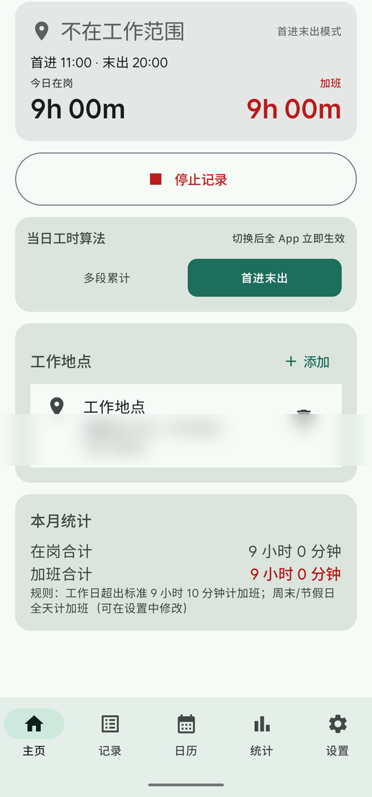
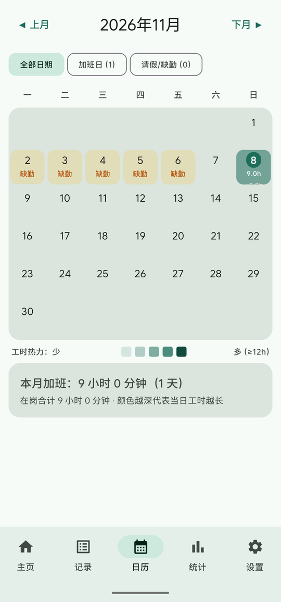
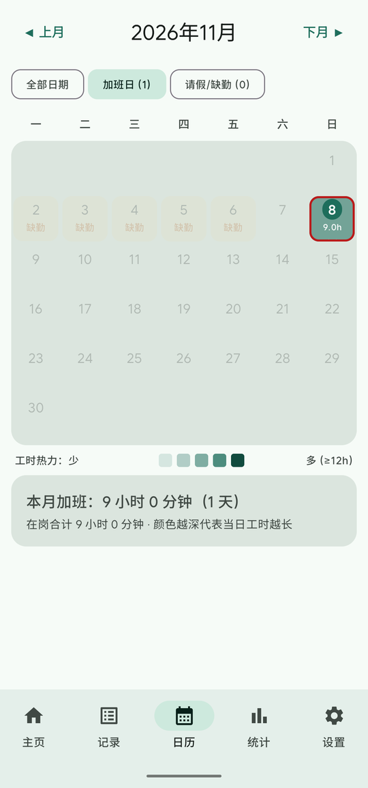
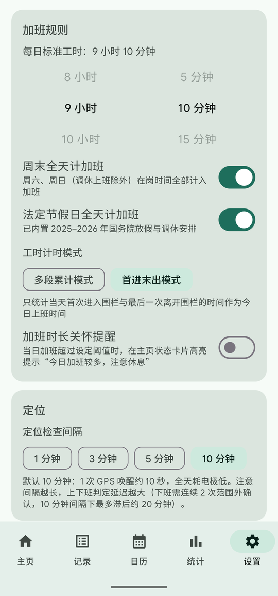

# 牛马时录 (WorkTimeTrace)

**把公司位置设为地理围栏，进出自动打卡，加班一目了然的安卓考勤 App。** 数据仅存本机，不联网上传；专为**中国大陆 / 国产手机**设计（不依赖 Google Play Services，内置高德地图选点）。

| 主页 · 实时在岗 | 日历 · 工时热力图 | 筛选 · 加班日高亮 | 设置 · 规则可调 |
|---|---|---|---|
|  |  |  |  |

## 它解决什么问题

- **打卡靠忘**：进入公司范围自动记上班、离开自动记下班，全程无感，忘了打卡也能事后补录
- **加班说不清**：每天在岗/加班时长自动统计，日历热力图直观呈现整月忙碌分布，一键筛出所有加班日和缺勤日
- **午休外出被扣时间**：两种计时算法自由切换——「首进末出」忽略中午外出，外出就餐不损失工时；「多段累计」严格按实际停留计算
- **手机没电通宵误算**：在岗心跳持续落盘，关机/离线后开机自动按最后心跳回溯结算下班卡
- **GPS 漂移误打卡**：动态迟滞双半径围栏（进严出宽 + 劣质精度过滤），室内窗边、电梯场景不误判

## 下载安装

| 渠道 | 地址 |
|---|---|
| 🇨🇳 蓝奏云（国内直连，推荐） | https://wwbsg.lanzouq.com/iR8rO49b8s8j 密码: `evz8` |
| GitHub Releases | https://github.com/lutcraft/workTimeTrace/releases/latest |

当前版本 **v1.2.0**（2026-11-08）。下载 APK 直接安装（需允许"安装未知应用"）。

## 功能总览

### 核心打卡
- 🗺️ **地图选点**：高德地图点选工作地点、滑块设置打卡半径（50–1000 米），也支持手动输入经纬度 / 一键取当前位置；支持多个工作地点
- ⏱️ **自动打卡**：前台服务 + 周期融合定位，进入记上班、离开记下班（连续 2 次确认防漂移）
- ✍️ **记录管理**：按月查看每天在岗时段与加班；支持补录 / 编辑 / 删除（单条或整天）

### 统计规则
- 📊 工作日超出**标准工时**（默认 8h，滚轮可调）计加班；周末 / 法定节假日全天计加班（内置 2025–2026 国务院放假调休表，可开关）
- ⚖️ **双计时模式**（主页/设置均可切换，主页显示两种算法对比）：
  - **首进末出**：当日首次进入 → 最后一次离开的时间跨度，午休外出不扣时
  - **多段累计**：各段在围栏内停留取并集，中途离开不计入

### v1.2.0 新增（同步 Niu-TimeTrace 设计）
- 🔥 **日历工时热力图**：六档绿色色阶呈现每日工时（0h → ≥12h），深浅色适配；**三态筛选**（全部 / 加班日 / 请假·缺勤，带当月计数）一键定位加班日与异常日
- 🛡️ **异常自愈**：启动即在围栏内自动补上班卡；在岗心跳持久化，关机/离线后开机按最后心跳回溯补下班卡；跨天未闭合记录自动闭合
- 🧲 **迟滞双半径围栏**：进入 dist ≤ 半径即确认；离开需超出「半径 + 25m + 精度×0.5」且连续确认，劣质精度（>250m）直接跳过判定
- 📤 **月度流水 CSV 导出**：完整进出记录（时间戳/坐标/备注），UTF-8 BOM，Excel 直接打开
- ❤️ **加班关怀提醒**：当日加班超阈值（0.5–6h 滑杆可调，默认关闭）时主页高亮提示"今日加班较多，注意休息"

### 其他
- 🔄 开机 / 应用更新后自动恢复记录服务；常驻通知实时显示在岗状态与当日累计
- 🧰 诊断日志一键导出（不含位置历史），反馈问题更高效
- 🌓 深色模式完整适配

## 环境要求

| 项 | 版本 |
|---|---|
| Android Studio | Hedgehog (2023.1.1) 及以上 |
| JDK | 17（Android Studio 自带） |
| Android SDK | compileSdk 34, minSdk 26（Android 8.0+） |
| Gradle | 8.9（项目自带 wrapper） |

## 构建

```bash
# 1. 用 Android Studio 打开本项目根目录，等待 Gradle Sync
# 2. 命令行构建：
./gradlew assembleDebug

# 运行单元测试（17 个：工时引擎 + 迟滞围栏）
./gradlew testDebugUnitTest
# 产物：app/build/outputs/apk/debug/app-debug.apk
```

> **从源码构建须知**：高德地图与定位服务绑定 APK 签名。自行构建的 APK 若签名不同，地图底图与高德定位不可用——App 会自动降级为系统定位，打卡与统计功能完全不受影响。签名配置方法见 `local.properties.example`。

## 定位说明

App 内置**双定位通道**：优先使用高德融合定位（无 GMS 依赖）；高德定位不可用时自动降级为系统 LocationManager 定位，进出判定、打卡、统计全部正常，仅地图选点页无底图（可用"回到当前位置"或手动输入经纬度选点）。

## 使用流程

1. 安装后打开 App，主页点击 **开始记录**，按提示授予：定位 → 后台定位 → 通知 → 忽略电池优化
2. 点 **工作地点 → 添加**，在地图上选中公司位置和半径（建议 ≥150 米），保存
3. 之后进入范围自动记上班，离开自动记下班；**日历页**看热力图和加班分布，**记录页**补录/导出 CSV，**设置页**调规则

## 国产手机保活（重要）

后台定位服务常被国产 ROM 杀掉，除 App 内一键"电池优化白名单"外，建议在系统设置中手动开启：

| 厂商 | 设置路径 |
|---|---|
| 小米/红米 | 设置 → 应用设置 → 应用管理 → 牛马时录 → 省电策略 → **无限制**；并开启**自启动** |
| 华为/荣耀 | 设置 → 应用 → 应用启动管理 → 关闭"自动管理"，手动开启全部三项 |
| OPPO/一加 | 设置 → 电池 → 应用耗电管理 → 牛马时录 → 允许完全后台行为 |
| vivo | 设置 → 电池 → 后台高耗电 → 允许牛马时录 |

把 App 从最近任务**加锁**（下拉卡片上的锁图标）效果最好。若服务被杀，开机或打开 App 会自动恢复。

## 技术栈

- Kotlin 1.9 + Jetpack Compose（Material 3）+ Navigation Compose
- Room（事件/工作地点存储）+ DataStore（规则设置与在岗心跳）
- 高德定位 SDK（融合定位，无 GMS 依赖）+ 高德 3D 地图 SDK（选点）
- 前台服务（`foregroundServiceType="location"`）+ 开机广播自启
- JUnit 单元测试覆盖工时引擎与围栏状态机

## 统计规则说明

- 一次"在岗区间" = 一条上班事件（ENTER）到配对的下班事件（EXIT）；跨午夜的区间按自然日切分归属
- 同一天多段区间取**并集**（重叠不重复计算）；「首进末出」模式下当日工时 = 末次离开 − 首次进入
- 工作日加班 = max(0, 在岗总时长 − 标准工时)；休息日（周末/法定节假日，扣除调休上班日）在岗按开关决定是否全天计加班
- 未闭合的上班事件（仍在岗）实时计入今天

## 目录结构

```
app/src/main/java/com/worktime/trace/
├── WorkTimeTraceApp.kt      # 应用入口，高德隐私合规初始化
├── MainActivity.kt
├── data/                    # Room 实体/DAO、DataStore 设置、仓库
├── geo/                     # Haversine 距离、迟滞双半径围栏状态机
├── service/                 # 前台定位服务、开机自启/关机心跳冻结
├── stats/                   # 加班计算（双模式）、节假日日历
└── ui/                      # Compose 界面（主页/地图/记录/日历/统计/设置）
app/src/test/                # 17 个 JVM 单元测试
```

## 已知限制

- 法定节假日表内置 2025–2026 年，之后的年份按纯周末规则处理（可在记录页查看当天标记）
- 定位精度受环境影响（市区 GPS 约 10–50 米，室内偏基站/WiFi 定位更差），半径建议不要低于 150 米
- 打卡时间有定位间隔级别的误差：默认 10 分钟间隔下，上班最多晚 10 分钟记、下班需连续 2 次范围外确认最多晚约 20 分钟；要求更及时可在设置页调短间隔
- 系统关机瞬间的 SHUTDOWN 广播不保证送达（Android 平台行为），在岗心跳主要依赖围栏内每次定位刷新，关机冻结仅为兜底

## 真机实测记录

<details>
<summary>2026-11-08 · v1.2.0 · MEIZU 20 Pro / Android 15 / Flyme（点开查看）</summary>

- ✅ 双计时模式实时切换：同一数据「首进末出 9h / 多段累计 7h」，主页对比行同步刷新
- ✅ 补录 / 编辑 / 删除全套 CRUD，与数据库逐条对应
- ✅ 日历热力图六档色阶、缺勤琥珀标记、加班日筛选红环高亮
- ✅ 关怀提醒：阈值滑杆 5.5h → 主页红色警示卡即时出现
- ✅ CSV 导出：文件生成 + 系统分享面板（微信/QQ/邮件）
- ✅ 迟滞围栏链路：定位回调携带精度、间隔调整即时生效、距围栏 2km 未误判
- ✅ 真关机 + 开机：BOOT_COMPLETED 自启恢复前台服务（1.4s 内定位恢复）；SHUTDOWN 瞬间广播未送达为平台行为，心跳主路径不依赖它
- ✅ 周日全天计加班、未闭合 ENTER 实时收尾、孤立 EXIT 显示"记录未配对"

</details>

<details>
<summary>2026-09-19 · v1.1.0 · MEIZU 20 Pro（点开查看）</summary>

- ✅ 安装、权限授予、前台服务与常驻通知实时刷新
- ✅ 地图页选点保存（含"回到当前位置"自动取坐标）
- ✅ 进入范围自动上班（ENTER 落库，主页转"在岗中"）
- ✅ 离开范围自动下班（移远 5.5km 模拟，2 次确认后 EXIT）
- ✅ 周六"休"标记、全天计加班、月汇总、区间并集正确
- ✅ 高德定位不可用时自动降级系统定位，全功能可用
- 🔧 实测发现并修复：魅族网络定位跨城漂移 → GPS 锚点一致性过滤；定位回调并发竞态 → 状态机加锁 + 回调串行化

</details>

## 许可证

[Apache License 2.0](LICENSE) © 2026 lutcraft
